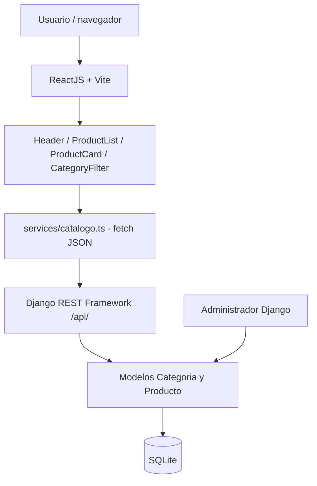

# Guía de capturas y descripción — Laboratorio 13

**Debes tomar capturas reales de tu equipo** e insertarlas en el documento del profesor, con breve descripción debajo. No se incluyen capturas inventadas.

| Ejercicio | Evidencia a capturar | Descripción sugerida |
|---|---|---|
| 01 | Diagrama React → API → SQLite y ficha de negocio | Analicé una tienda de accesorios tecnológicos, sus categorías, campos de producto y la comunicación REST. |
| 02 | Explorador VS Code `frontend` / `backend`, Vite y consola de build | Organicé el proyecto en dos directorios, instalé Tailwind y shadcn/ui y comprobé la compilación. |
| 03 | Código `Header.tsx` y pantalla de inicio | Implementé la cabecera con identidad NOVA TECH y navegación. |
| 03 | Código `ProductCard.tsx` y catálogo | Usé props para representar nombre, precio, imagen, descripción y categoría. |
| 03 | Código `CategoryFilter.tsx` con selección de categorías | El estado de React permite cambiar los productos visualizados según la categoría. |
| 04 | `models.py` y `admin.py` | Definí Categoria y Producto con relación de uno a muchos, y registré ambos en el panel. |
| 04 | `makemigrations`, `migrate`, administrador Django | Se crearon las tablas y se registraron 4 categorías y 12 productos de ejemplo. |
| 04 | URLs JSON en navegador `/api/categorias/` y `/api/productos/` | Confirmé respuestas HTTP 200 y el contenido JSON. |
| 05 | `services/catalogo.ts` y `CatalogoPage.tsx` | Con fetch, useEffect y useState obtengo datos reales desde Django. |
| 05 | Catálogo filtrando Audio y Gaming | Verifiqué que los productos cambian con las categorías devueltas por la API. |
| 05 | Admin: editar precio; tienda: precio actualizado | Comprobé que el cambio en SQLite se refleja en React al actualizar la página. |
| 06 | Pantalla móvil y escritorio | Probé que las tarjetas se reorganizan con diseño responsive. |
| 06 | Backend parado, mensaje de error, reintentar | Comprobé los estados de carga y error del cliente REST. |
| 06 | `manage.py test` (3 tests) y `npm.cmd run build` | Verifiqué automáticamente las respuestas de la API y la compilación de frontend. |
| 06 | Repositorio GitHub y su URL | Subí el código fuente y documenté el enlace en la entrega. |

## Esquema de arquitectura (ejercicio 01)

## Observaciones sugeridas (adáptalas a tu experiencia real)
- Al configurar el proyecto encontré una incompatibilidad de `baseUrl` con TypeScript 6. La resolví eliminando la opción obsoleta y ejecutando nuevamente el build.
- La terminal PowerShell no permitía ejecutar `npm.ps1`, por lo que usé `npm.cmd` para administrar paquetes sin modificar la política de seguridad del equipo.
- Git no estaba disponible inicialmente; fue necesario instalarlo o utilizar una versión portátil para subir el proyecto a GitHub.

## Conclusiones sugeridas (redacción de estudiante)
- Comprendí mejor cómo se separa un frontend hecho con React de un backend Django, porque ambos tienen tareas distintas y se comunican por una API REST.
- Aprendí a usar props para mostrar información dentro de tarjetas reutilizables y `useState` para modificar los filtros sin recargar la página.
- Con `useEffect` y `fetch` pude dejar de usar información fija y mostrar productos registrados en una base de datos SQLite.
- El panel de administración de Django facilitó agregar y modificar productos, y pude comprobar que los cambios aparecen en la tienda después de actualizar el catálogo.
- Considero que la estructura es una base adecuada para agregar en futuros laboratorios un carrito de compras, pedidos y usuarios, sin mezclar esas funcionalidades con el alcance actual.
